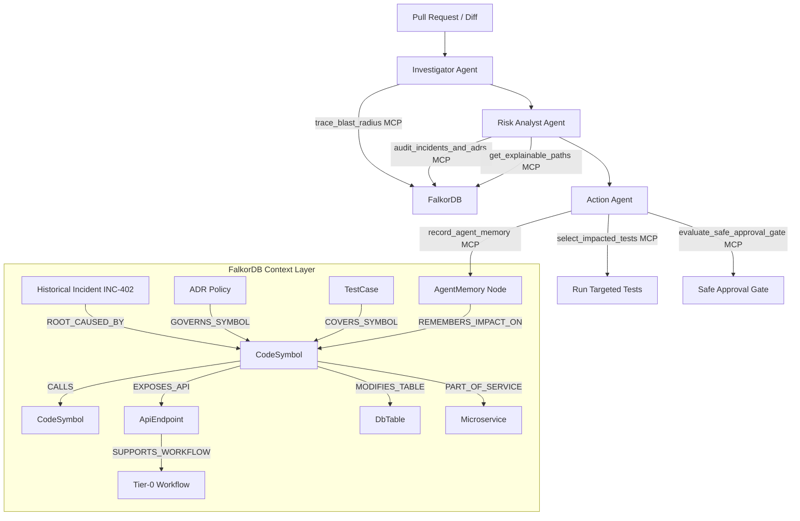

# RippleGuard: Multi-Agent Change-Impact Intelligence System

> **FalkorDB Hackathon Track:** Agents That Act on Connected Data  
> **Core Concept:** An autonomous multi-agent intelligence layer that uses **FalkorDB** as its mandatory, decision-making context and cross-session memory layer to trace blast radius, evaluate architectural risk, select and execute targeted tests, enforce safe approval gates, and persist cross-session learnings.

---

## 🚀 The Shift: Graph as the Decision-Making Context

Conventional CI/CD and coding agents view code changes in isolation (flat git diffs). They miss how changes ripple across microservice boundaries, database tables, and business-critical revenue workflows. They lose track of past outages and cannot explain *why* an action was chosen.

**RippleGuard puts the agent's context entirely in FalkorDB.** Code symbols, APIs, database schemas, workflows, microservices, tests, CODEOWNERS, historical P1/P2 incidents, and Architectural Decision Records (ADRs) become nodes and edges that agents follow.



---

## 🎯 Key Capabilities

1. **Multi-Hop Traversal & Blast Radius Discovery**
   - Traces direct and transitive caller/callee paths across microservice boundaries (e.g. `PaymentGateway.verify_jwt_token` $\rightarrow$ `PaymentGateway.authorize_charge` $\rightarrow$ `POST /v1/payments/charge` $\rightarrow$ `WF-01: Instant Checkout` Tier-0 workflow).
2. **Explainable Results with Graph Evidence**
   - Automatically computes shortest paths showing *why* a changed component impacts revenue-generating workflows or past outages (e.g. Incident INC-402, $320,000 revenue loss).
3. **Multi-Factor Risk Score (0 - 100)**
   - Transparent 4-factor scoring:
     - **Workflow Criticality (0-30 pts):** Tier-0, Tier-1, or Tier-2 business journey impact.
     - **Historical Incident Linkage (0-25 pts):** Correlates with past P1/P2 incidents in FalkorDB.
     - **Blast Reach (0-25 pts):** Microservice, API, and DB table reach.
     - **ADR Governance & Data Sensitivity (0-20 pts):** PCI-restricted tables, rotation policies.
4. **Smart Test Selection (CI Time Savings)**
   - Queries FalkorDB coverage edges (`COVERS_SYMBOL`, `COVERS_TABLE`, `VERIFIES_WORKFLOW`) to isolate only the exact tests impacted by the change, executes them via `pytest`, and reports live pass/fail.
5. **Safe Approval Gates**
   - Consequential action control: changes touching Tier-0 workflows or high-risk thresholds are held (`BLOCKED_REQUIRES_DUAL_LEAD_APPROVAL` or `HOLD_REQUIRES_STAFF_APPROVAL`). Lead approvals/rejections are logged to FalkorDB as permanent audit memories.
6. **Persistent Cross-Session Graph Memory**
   - Stores review findings, risk scores, and decisions back into FalkorDB as `AgentMemory` nodes with links to impacted components, enabling future sessions to remember past evaluations and learn from previous reviews.

---

## 🤖 Multi-Agent Architecture & MCP Tool Protocol

RippleGuard employs three specialized agents operating sequentially through formal Model Context Protocol (MCP) tools:

| Agent | Responsibility | Primary MCP Tools Invoked |
| :--- | :--- | :--- |
| **Investigator Agent** | Ingests PR diff, resolves symbols, traverses multi-hop dependency graph | `trace_blast_radius` |
| **Risk Analyst Agent** | Calculates topological centrality, queries historical incident memory and ADR compliance, calculates multi-factor risk score | `calculate_graph_metrics`, `audit_incidents_and_adrs`, `get_explainable_paths` |
| **Action Agent** | Executes targeted tests, routes notifications to CODEOWNERS, enforces safe approval gates, and commits cross-session memory to FalkorDB | `select_impacted_tests`, `run_targeted_tests`, `find_stakeholders`, `evaluate_safe_approval_gate`, `record_agent_memory` |

---

## 🔬 Sample Microservice Architecture in FalkorDB

RippleGuard includes a realistic microservice codebase in `services/`:

- **`payment-service`** (`PaymentGateway`): Auth tokens, charge capture, refunds, `payments_ledger` (PCI-Restricted).
- **`order-service`** (`OrderController`, `OrderWorkflow`): Cart checkout orchestration, order state transitions.
- **`inventory-service`** (`InventoryLocker`): Distributed stock reservation, lock timeouts (`inventory_allocations`).
- **`notification-service`** (`NotificationClient`): Transactional emails and delivery audit logging.

### Graph Entities (56 Nodes, 109 Edges)
- **`Microservice`**: `PaymentService`, `OrderService`, `InventoryService`, `NotificationService`, `UserService`
- **`CodeSymbol`**: Core methods and classes in each service
- **`ApiEndpoint`**: REST and gRPC interfaces
- **`DbTable` & `DbColumn`**: Relational tables, columns, and classification tags
- **`Workflow`**: `WF-01: Instant Checkout` ($450k/hr Tier-0), `WF-02: Subscription Billing` ($120k/hr Tier-0), `WF-04: Inventory Reservation` (Tier-1), `WF-05: Customer Notifications` (Tier-2)
- **`TestCase`**: Unit, integration, security, and schema contract tests
- **`Team` & `Engineer`**: CODEOWNERS, Slack channels, on-call leads
- **`Incident`**: Past P1/P2 outage records (`INC-402`, `INC-291`, `INC-118`)
- **`ADR`**: Architectural Decision Records (`ADR-042`, `ADR-019`, `ADR-057`)
- **`AgentMemory`**: Persistent cross-session review memories

---

## 🧪 Demonstration Scenarios

RippleGuard provides 4 pre-configured scenarios selectable directly in the dashboard:

| Scenario | PR Description | FalkorDB Impact Traversal | Risk Score & Gate |
| :--- | :--- | :--- | :--- |
| **PR-104** | Refactor PaymentGateway auth token to strict JWT | Touches `verify_jwt_token` $\rightarrow$ `authorize_charge` $\rightarrow$ `WF-01: Instant Checkout` (Tier-0) $\rightarrow$ matches `INC-402` (P1 Outage: $320k lost) & `ADR-042` | **100/100 [CRITICAL]**<br>`BLOCKED_REQUIRES_DUAL_LEAD_APPROVAL` |
| **PR-105** | Reduce Inventory lock timeout to 2000ms | Touches `acquire_lock` $\rightarrow$ `WF-04: Inventory Reservation` (Tier-1) $\rightarrow$ matches `INC-291` (P2 Race condition) & `ADR-057` | **58/100 [HIGH]**<br>`HOLD_REQUIRES_STAFF_APPROVAL` |
| **PR-106** | Add Welcome email template to mailer | Touches `send_receipt` $\rightarrow$ `WF-05: Customer Notifications` (Tier-2). No incidents, no Tier-0 workflows | **24/100 [LOW]**<br>`AUTO_APPROVED` (83% CI time saved) |
| **PR-107** | Drop orders.archived_flag column | DB Schema migration touching `orders` table and `OrderWorkflow` $\rightarrow$ triggers schema contract test | **100/100 [CRITICAL]**<br>`BLOCKED_REQUIRES_DUAL_LEAD_APPROVAL` |

---

## 💻 Running RippleGuard Locally

### Prerequisites
- Python 3.10+
- (Optional) FalkorDB Server running via Docker or FalkorDB Cloud.  
  *Note: RippleGuard includes a dual-mode adapter: if an external FalkorDB server is detected on port 6379 or `FALKORDB_URL`, it connects immediately; otherwise, it operates seamlessly using its built-in FalkorDB Cypher Engine with zero external dependencies.*

### 1. Install Dependencies
```bash
pip install -r requirements.txt
```

### 2. (Optional) Run FalkorDB in Docker
```bash
docker run -p 6379:6379 -it --rm falkordb/falkordb:latest
```

### 3. Start the RippleGuard Server
```bash
python -m uvicorn backend.server:app --host 127.0.0.1 --port 8000
```

### 4. Open the Interactive Dashboard
Navigate in your browser to:
```
http://127.0.0.1:8000/
```

### 5. Run the Automated Test Suite
```bash
python -m pytest tests/
python tests/test_api_scenarios.py
```

---

## 🖥️ Interactive Features in the Dashboard

- **Live Cytoscape Graph Canvas:** Visualizes the full microservice topology. Automatically animates radiant highlights on blast radius nodes and impact paths.
- **Node Inspector:** Click any node to reveal upstream callers, downstream callee dependencies, and linked metadata.
- **Multi-Agent Reasoning Trace Timeline:** Inspect step-by-step thinking and MCP tool invocations for Investigator, Risk Analyst, and Action agents.
- **Smart Test Runner:** View targeted test selection, execution duration, and live pass/fail results.
- **Safe Approval Gate Modal:** Simulate senior engineer approval or rejection with notes recorded directly to FalkorDB memory.
- **Interactive FalkorDB Cypher Console:** Run custom openCypher queries directly against FalkorDB and view tabular results.
- **Cross-Session Memory Inspector:** Review memories persisted across previous analysis sessions.

---

## 📄 License
MIT License. Built for the FalkorDB Hackathon 2026.
